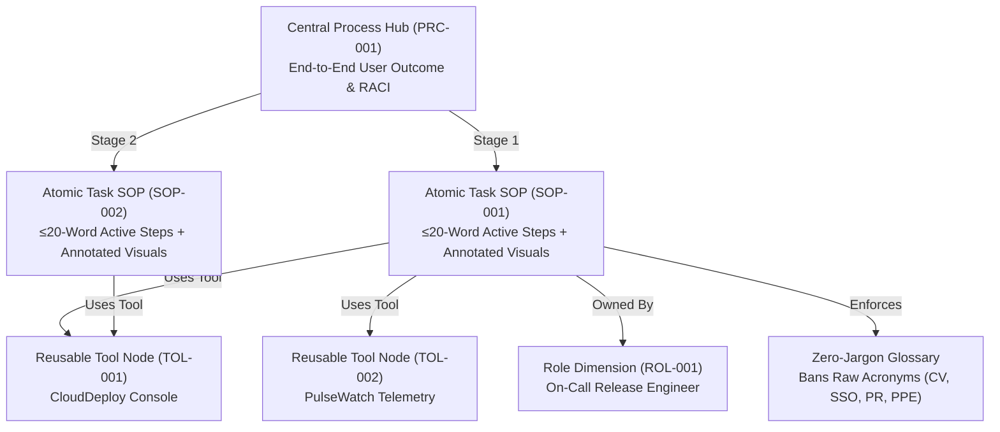

# ❄️ Snowflake Documentation Playbook & Framework Architecture

This repository contains both:
1. **An Interactive JSON-Driven Documentation Platform** ([`index.html`](file:///e:/Coding%20Projects/SOP%20Guide%20manager/index.html) + [`app.js`](file:///e:/Coding%20Projects/SOP%20Guide%20manager/app.js)) where users select guides from a searchable menu and view visual-first instructions.
2. **A Relational Snowflake Data Schema & Template Suite** ([`data/guides.json`](file:///e:/Coding%20Projects/SOP%20Guide%20manager/data/guides.json) + [`schemas/snowflake-doc.schema.json`](file:///e:/Coding%20Projects/SOP%20Guide%20manager/schemas/snowflake-doc.schema.json)) so authors can build or update guides using simple JSON data files.

---

## 1. The Relational "Snowflake Schema" Architecture

Instead of monolithic manuals that go stale, every guide is normalized into reusable JSON entities inside [`data/guides.json`](file:///e:/Coding%20Projects/SOP%20Guide%20manager/data/guides.json):



---

## 2. The 4 Core Usability Pillars (Enforced by [`scripts/validate-guides.js`](file:///e:/Coding%20Projects/SOP%20Guide%20manager/scripts/validate-guides.js))

### Pillar 1: Visual-First Design
* **Annotated Diagrams on Every Step:** Every SOP step includes a declarative `visual` block in JSON that automatically renders a UI or hardware diagram with a **dashed gold highlight box**, **numbered callout banner**, and **directional pointer arrow**.
* **Contextual Delivery Modes:** Users can toggle any guide between:
  * **📖 Standard Guide:** Balanced two-column density (action on left, annotated visual on right).
  * **🎯 "Guide Me" HUD Overlay:** A compact floating step-by-step coach for live software workflows.
  * **🖨️ Workstation Poster:** Strips navigation chrome for 1-page laminated shop-floor posters.

### Pillar 2: Radical Text Brevity
* **The 20-Word Rule:** Every step's `action` field is strictly capped at **20 words** (Simplified Technical English standard) and displays a live word-budget badge (`12/20 words`).
* **Active Voice Only:** Steps must start with direct imperative verbs (*"Turn the blue main pressure control valve..."*, *"Click the green 'Stage Canary' button..."*).
* **Zero Acronyms or Jargon:** Raw acronyms (`CV`, `SSO`, `PR`, `PPE`) are blocked by the validator so readers never have to stop and look up terms.

### Pillar 3: Task-Focused + Value-Add Coaching
* **User-Centric Framing:** Guides are titled and organized by **what the user wants to achieve** (*"Depressurize and Swap the Bay 4 Cooling Filter"*), not product component names.
* **Value-Add Coaching (`coachingTip`):** Every step teaches the user how to get the best possible outcome (e.g., wetting the rubber O-ring with clean water to prevent 90% of post-swap drips).

### Pillar 4: Predictable Structural Anchors
Every SOP and Tool page locks in three fixed anchor points:
1. **Searchable Table of Contents** (Left sidebar with instant filter by keyword, symptom, tool, or role)
2. **"Getting Started" Section** (Isolates one-time setup or safety gear from daily operation)
3. **Troubleshooting & Self-Service Fixes** (Immediate `Symptom → Cause → Instant Fix` table at the bottom of every guide)

---

## 3. How to Add a New Guide via JSON

1. Open [`data/guides.json`](file:///e:/Coding%20Projects/SOP%20Guide%20manager/data/guides.json) (or click **⚡ Load / Edit JSON Data** in the web platform).
2. Add or link your **Tool** (`TOL-xxx`), **Process** (`PRC-xxx`), and **SOP** (`SOP-xxx`).
3. Run the automated quality & schema validator:
   ```powershell
   node scripts/validate-guides.js
   ```
4. Refresh [`index.html`](file:///e:/Coding%20Projects/SOP%20Guide%20manager/index.html) to browse your new guide in the menu.
